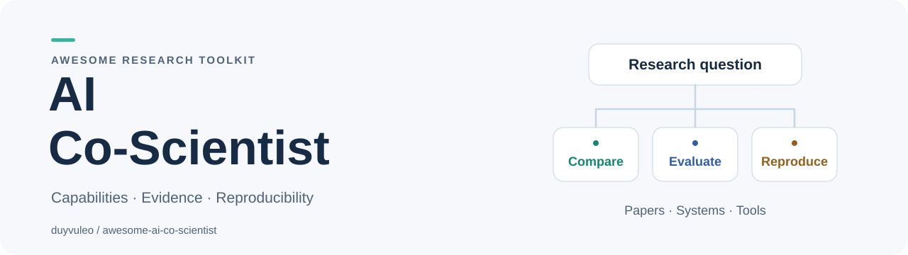
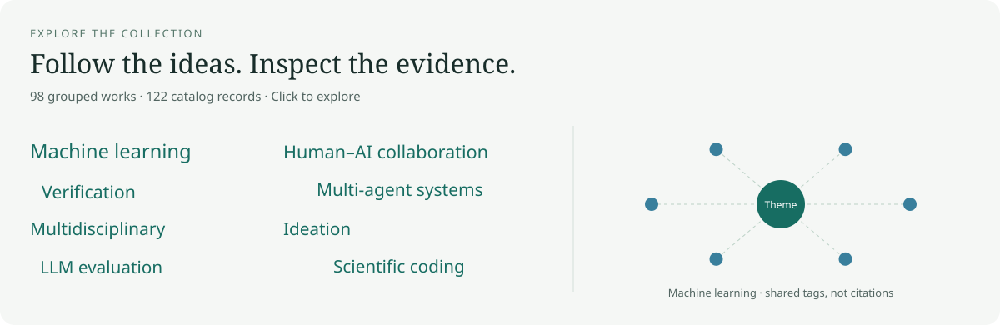

<!-- Generated by scripts/render.py from data/. Edit the source, then regenerate. -->
<picture>
  <source media="(prefers-color-scheme: dark)" srcset="assets/banner-dark.svg">
  
</picture>

# Awesome AI Co-Scientist

> Curated papers, systems, tools, and benchmarks for AI-assisted scientific discovery.

AI agents can propose scientific hypotheses, write and run experimental code, and turn research records into manuscripts. This collection examines systems such as [Google Co-Scientist](docs/systems.md#google-co-scientist-system), [Agentic Scientist](docs/systems.md#agentic-scientist-system), and [DiscoveryRSI](docs/systems.md#discoveryrsi-system): how they work, what they produce, and what their evaluations establish. Compare available code, inspect benchmark results and observed failures, and use evaluation guides to design your own studies.

[Browse papers](docs/papers.md) · [Compare systems](docs/capability-matrix.md) · [Read local experiments](docs/reproducibility.md) · [Contribute](CONTRIBUTING.md)

Latest source check: **2026-10-27**. Entries include summaries, publication status, primary sources, and inspection dates. Papers and software are counted separately.

## Contents

- [Explore visually](#explore-visually)
- [Selected reading](#selected-reading)
- [Choose a reading route](#choose-a-reading-route)
- [Papers](docs/papers.md)
- [Systems](docs/systems.md) and [tools](docs/tools.md)
- [Benchmarks](docs/benchmarks.md)
- [Capability and evidence matrix](docs/capability-matrix.md)
- [Evaluation guide](docs/evaluation-guide.md)
- [Research outputs](docs/research-outputs.md)
- [Research synthesis](docs/research-synthesis.md)
- [Local experiments and study guides](#local-experiments-and-study-guides)
- [Recent additions](#recent-additions)
- [Curation and daily updates](#curation-and-daily-updates)
- [Contributing](#contributing)
- [Related collections](#related-collections)

## Explore visually

Browse research themes, follow resource connections, and inspect the evidence behind each work.

[Open the interactive explorer](https://duyvuleo.github.io/awesome-ai-co-scientist/) · [Methods and coverage](docs/explorer.md)

## Selected reading

Selected resources, newest first. Year-only entries follow dated entries within each year; all catalogs retain topic indexes.

| Date | Resource / status | Summary & evidence | Links |
| --- | --- | --- | --- |
| <code>2026&#8209;10&#8209;13</code> | [The Agentic Scientist: Orchestrating Coding Agents for Automated Scientific (Co-)Discovery](https://arxiv.org/abs/2610.18933) *preprint* | Coordinates coding agents through task drafting, ideas, sandboxed experiments, baselines, ablations, analysis, and manuscript writing. A meta-controller enforces stage-specific rubrics. The paper reports computational discovery studies and an ALIFE 2026 paper produced in a co-scientist setting; that human collaboration should be distinguished from its separate autonomous evaluations. | [Details](docs/papers.md#agentic-scientist) |
| <code>2026&#8209;09&#8209;17</code> | [ScientistTwo: Pioneering the Human Knowledge Frontier with Autonomous AI](https://arxiv.org/abs/2609.19644) *preprint* | Starts from a research problem, establishes baselines, proposes hypotheses, runs experiments and ablations, and iterates through simulated reviews. Evaluation includes publication-derived machine-learning tasks, integrity audits, automated reviewers, and a human study of generated papers. These complementary author-reported assessments remain bounded by the selected tasks; simulated acceptance is distinct from actual venue acceptance. | [Details](docs/papers.md#scientist-two) |
| <code>2026&#8209;09&#8209;15</code> | [ScienceBuddy: Recursive-in-Recursive Self-Improvement for Interactive Scientific Agents](https://arxiv.org/abs/2609.17523) *preprint* | Turns researcher requests, feedback, and execution traces into learning tasks and evaluation rubrics. An inner loop adapts the agent harness while an outer loop trains the model under the improved harness. Case studies cover four scientific task families; they demonstrate the proposed learning workflow rather than universal autonomous discovery. | [Details](docs/papers.md#sciencebuddy) |
| <code>2026&#8209;07&#8209;03</code> | [ResearchStudio](https://github.com/microsoft/ResearchStudio) *preprint* | Microsoft's research skill collection includes Idea for developing literature-grounded research proposals and Reel for turning completed papers into posters, narrated videos, blogs, and interactive presentations. The code exposes editable workflows for coding agents. Its two modules support different stages of research and communication; their presence does not establish an autonomous experimental discovery pipeline. | [Paper](https://arxiv.org/abs/2607.04439) · [Details](docs/tools.md#researchstudio-tool) |
| <code>2026&#8209;05&#8209;25</code> | [ScientistOne: Towards Human-Level Autonomous Research via Chain-of-Evidence](https://arxiv.org/abs/2605.26340) *preprint* | Maintains explicit evidence chains from literature and experiments to manuscript claims, with audits for score reproduction, specification violations, references, and method-code agreement. The authors compare generated papers across research tasks and report improved integrity. These are task-specific audits, so the title's human-level claim should not be generalized to all research. | [Details](docs/papers.md#scientist-one) |
| <code>2026&#8209;05&#8209;19</code> | [Accelerating scientific discovery with Co-Scientist](https://www.nature.com/articles/s41586-026-10644-y) *peer reviewed* | Uses specialized agents to generate, criticize, rank, and evolve hypotheses through tournaments, with scientists setting goals and steering exploration. The Nature paper includes biomedical applications and laboratory validation of selected hypotheses. The system supports scientific reasoning; experimental validation remains a distinct process rather than an automatically closed physical loop. | [Details](docs/papers.md#google-co-scientist) |
| <code>2026&#8209;04&#8209;06</code> | [PaperOrchestra](https://github.com/google-research/paper-orchestra) *preprint* | Transforms research ideas, experimental records, and formatting requirements into LaTeX manuscripts through specialized planning, literature, plotting, writing, and refinement agents. The official Google Research repository accompanies the paper and evaluation resources. It addresses synthesis of existing research materials; manuscript quality ratings do not verify that the underlying experiments or scientific conclusions are correct. | [Paper](https://arxiv.org/abs/2604.05018) · [Details](docs/tools.md#paperorchestra-tool) |
| <code>2026</code> | [OpenResearch](https://github.com/alphaXiv/OpenResearch) *project* | A local research workspace and harness from alphaXiv that connects coding agents to literature discovery, experiment execution, and artifact inspection. It records experiments in a local database and supports multiple compute backends. The repository documents a usable product; these capabilities are project claims rather than an independently established discovery benchmark. | [Details](docs/systems.md#openresearch-system) |
| <code>2025&#8209;04&#8209;02</code> | [PaperBench](https://arxiv.org/abs/2504.01848) *peer reviewed* | Asks agents to implement and execute replications of 20 ICML 2024 papers from scratch. Author-developed hierarchical rubrics divide the work into 8,316 gradable items, with a separately assessed model-based grader. Scores indicate progress toward specified replication requirements; code-only variants, partial rubric credit, and successful empirical replication must be distinguished. | [Code](https://github.com/openai/frontier-evals) · [Details](docs/benchmarks.md#paperbench) |
| <code>2024&#8209;10&#8209;07</code> | [ScienceAgentBench](https://arxiv.org/abs/2410.05080) *peer reviewed* | Contains 102 expert-validated tasks derived from 44 publications across four disciplines. Each task requires a self-contained Python program, assessed through code, execution outputs, and costs. The benchmark deliberately tests individual data-driven research steps, providing a stronger basis for bounded capability claims than treating generated manuscripts as evidence of complete scientific discovery. | [Code](https://github.com/OSU-NLP-Group/ScienceAgentBench) · [Details](docs/benchmarks.md#scienceagentbench) |

## Choose a reading route

| Your question | Where to start |
| --- | --- |
| Which research stages can agents automate? | [Papers](docs/papers.md) and the [capability matrix](docs/capability-matrix.md) |
| What can I inspect or build on? | [Systems](docs/systems.md) and [tools](docs/tools.md), with availability notes |
| Which benchmark fits my experiment? | [Benchmarks](docs/benchmarks.md) and the [evaluation guide](docs/evaluation-guide.md) |
| What has automated research produced? | [Released research outputs](docs/research-outputs.md), including Recursive Flint |
| What has been tested locally? | [Component reproducibility reports](docs/reproducibility.md) |
| Which findings agree, and which questions remain open? | [Cross-paper synthesis](docs/research-synthesis.md) |
| How do agents support laboratory research? | [Domain-science papers](docs/papers.md#topic-domain-science) |

## Scope

We include systems that formulate hypotheses, conduct experiments, analyse results, or communicate scientific findings. Supporting tools and benchmarks are included when their role in these activities is explicit. General-purpose agents require a concrete connection to scientific research.

**Preprint**, **peer-reviewed**, and **project** identify source status. Peer review requires a linked publication record; project entries describe official documentation. **Content checked** records source inspection, not execution. Missing code links indicate unconfirmed availability.

Proposal ratings, successful execution, and validated discoveries measure different outcomes. Comparisons therefore retain the task, budget, human roles, and evaluation setting. Our local reports cover selected components; they do not reproduce complete research campaigns or published scientific findings.

## Local experiments and study guides

| Resource | Purpose |
| --- | --- |
| [Getting started](docs/start-here.md) | Inspect a system, examine a recorded failure, and prepare a study. |
| [Local search and exports](docs/cli.md) | Search, compare, and export catalog records using Python 3.10+. |
| [Evaluation protocols](docs/workflows/README.md) | Study [evaluator integrity](docs/workflows/evaluator-integrity.md), [idea selection](docs/workflows/idea-to-experiment.md), or [human collaboration](docs/workflows/human-ai-collaboration.md). |
| [Study packs](docs/study-packs.md) | Record protocols, budgets, execution details, and results. |
| [Reproducibility reports](docs/reproducibility.md) | Inspect pinned sources, commands, failures, and independent checks. |

Search and planning work offline without model calls. The two recorded component investigations used no paid APIs. Proposed protocols are labelled separately from executed experiments.

## Recent additions

Eight recent works, with one row per work and links to each catalog entry. Ordered by addition date; the Date column shows publication or release.

| Date | Resource / status | Summary & evidence | Links |
| --- | --- | --- | --- |
| <code>2026&#8209;10&#8209;23</code> | [SCI-AGENT-EXAM](https://arxiv.org/abs/2610.32441) *preprint* Added 2026-10-27 | Evaluates 120 scientific workflow tasks across eleven domains and seven task types, requiring executable artifacts and written reports. Hidden programmatic checks and rubric-based model judgments are reported separately before task-weighted aggregation. Trajectory snapshots expose regressions as well as progress. These controlled tasks assess specified outputs; high average scores or polished reports do not establish consistently correct execution or novel scientific discoveries. | [Details](docs/benchmarks.md#sci-agent-exam) |
| <code>2026&#8209;10&#8209;22</code> | [PaperScorer: How Predictable Is Paper Acceptance?](https://arxiv.org/abs/2610.31791) *preprint* Added 2026-10-27 | Trains text and vision models to predict acceptance from anonymized manuscripts, with stronger matched-source results from page images. ICLR inputs include rebuttal-era revisions, while arXiv rejection labels are inferred from missing proceedings matches. Accuracy concentrates at rating extremes and degrades across sources. The score estimates review outcomes; it does not establish correctness, novelty, or scientific impact. | [Code](https://github.com/zlab-princeton/PaperScorer) · [Paper details](docs/papers.md#paperscorer) · [Tool details](docs/tools.md#paperscorer-tool) |
| <code>2026&#8209;04&#8209;03</code> | [LitPivot: Developing Well-Situated Research Ideas Through Dynamic Contextualization and Critique within the Literature Landscape](https://arxiv.org/abs/2604.02600) *preprint* Added 2026-10-27 | Links proposal editing to changing literature: researchers select problem, contribution, or evaluation facets, inspect relevant paper clusters, and consider excerpt-backed critiques and revisions. A 17-participant study reports stronger expert-rated literature grounding, with a five-participant qualitative follow-up. Novelty benefits are self-reported; short HCI/NLP ideation tasks do not establish feasibility, successful experiments, or long-term research impact. | [Details](docs/papers.md#litpivot) |
| <code>2026&#8209;10&#8209;19</code> | [Autonomous adaptive spectral analysis with an LLM agent for self-driving laboratories](https://arxiv.org/abs/2610.25619) *preprint* Added 2026-10-26 | Uses an LLM to inspect spectra and diagnostics, adjust predefined fitting parameters within bounded retries, or abstain, while deterministic code calculates the physical quantity. On 203 archived film spectra, it retains 183 baseline values, recovers 16 failed analyses, and abstains on four. This retrospective, single-campaign study does not test live laboratory control or detection of physically incorrect results that pass numerical checks. | [Code](https://github.com/nttcslab/interpretable-SDL) · [Details](docs/papers.md#adaptive-spectral-analysis) |
| <code>2026&#8209;10&#8209;19</code> | [Bayesian Model Discovery with Language Models: Closing the Loop between Hypotheses and Experiments](https://arxiv.org/abs/2610.25747) *preprint* Added 2026-10-26 | Combines LLM-proposed functional forms with numerical parameter fitting, evidence-weighted predictions, and experiment selection by joint information gain over models and parameters. Four benchmarks compare predictive error and structural recovery, with ablations of numerical feedback. Results depend on the candidate pool, priors, and observation model; containing the true law as a special case is explicitly distinguished from recovering its exact form. | [Details](docs/papers.md#bayesian-model-discovery) |
| <code>2026&#8209;09&#8209;30</code> | [Agentic AI–Physicist Collaboration in Experimental Particle Physics: A Proof-of-Concept Measurement with LEP Open Data](https://doi.org/10.53941/hihep.2026.100010) *peer reviewed* Added 2026-10-26 | Demonstrates an agent-assisted thrust measurement from archived ALEPH collision data, including code execution, unfolding, uncertainty propagation, and manuscript drafting. Physicists supply prior analyses and context, define acceptance criteria, inspect results, and approve major decisions. The published contribution is a supervised analysis demonstration using a known observable, not an autonomous discovery or a controlled estimate of productivity gains. | [Code](https://github.com/Electron-Positron-Alliance/ALEPH_Analysis_Agentic_Thrust) · [Details](docs/papers.md#agentic-lep-thrust) |
| <code>2026&#8209;03&#8209;18</code> | [OpenScientist: evaluating an open agentic AI co-scientist to accelerate biomedical discovery](https://doi.org/10.64898/2026.03.15.26348338) *preprint* Added 2026-10-26 | Evaluates an open hypothesis-testing agent on four featured biomedical case studies and three supplementary cases, combining data analysis, literature retrieval, and reports. Expert review identifies useful results alongside preprocessing mistakes, statistical weaknesses, and incomplete rejection on randomized controls. Selected cases and human prompt/data refinement limit generalization; estimated time savings are not a controlled productivity comparison. | [Code](https://github.com/openscientist-io/openscientist) · [Paper details](docs/papers.md#openscientist) · [System details](docs/systems.md#openscientist-system) |
| <code>2026&#8209;10&#8209;21</code> | [Astro2Method](https://arxiv.org/abs/2610.30282) *preprint* Added 2026-10-25 | Tests machine-learning method selection with 500 expert-reviewed binary questions derived from 346 astronomy papers. Questions distinguish complete from partial methodological explanations. Historical retrieval and additional agent reasoning do not consistently improve accuracy; web-search gains concentrate on finding the source papers. This measures retrospective method judgments, not executing alternative methods or establishing prospective astronomical discoveries. | [Details](docs/benchmarks.md#astro2method) |

See the [changelog](CHANGELOG.md) for additions and corrections, and the [search notes](docs/search-papers.md) for source checks and coverage.

## Curation and daily updates

Daily curation checks primary sources for new work and project changes. We publish substantive additions and corrections after validation. See the [search protocol](docs/search-protocol.md) for coverage limits and the [changelog](CHANGELOG.md) for updates; coverage is not exhaustive.

This collection is AI-assisted and maintainer-owned. Automated checks validate catalog structure and generated files; scientific claims require source review.

## Contributing

Suggest a [resource or correction](https://github.com/duyvuleo/awesome-ai-co-scientist/issues/new?template=resource.yml), report a [reproduction attempt](https://github.com/duyvuleo/awesome-ai-co-scientist/issues/new?template=reproduction.yml), or share [practical experience](https://github.com/duyvuleo/awesome-ai-co-scientist/issues/new?template=experience.yml). Include sources, methods, and limitations; failed attempts are welcome. See the [contribution guide](CONTRIBUTING.md) and [open contribution topics](docs/community-roadmap.md).

The catalogs in [data/](data/) generate the indexes. The [data reference](docs/data-reference.md) explains their structure and reuse. Cite primary papers for scientific claims; use [CITATION.cff](CITATION.cff) and a commit ID when citing this collection.

## Related collections

- [Awesome Reliable Text-to-SQL](https://github.com/duyvuleo/awesome-reliable-text-to-sql) — A companion collection on ambiguity, clarification, and unanswerability.
- [Related AI-science collections](docs/search-landscape.md) — Coverage and differences among existing lists.
- [Awesome manifesto](https://github.com/sindresorhus/awesome/blob/main/awesome.md) — Guidance for curated collections. This repository is independent of the central index, whose [contribution rules](https://github.com/sindresorhus/awesome/blob/main/pull_request_template.md) exclude AI-generated lists.

## License

Original annotations, catalog records, and scripts use [CC0 1.0](LICENSE). Linked papers, software, data, and trademarks retain their respective terms.
