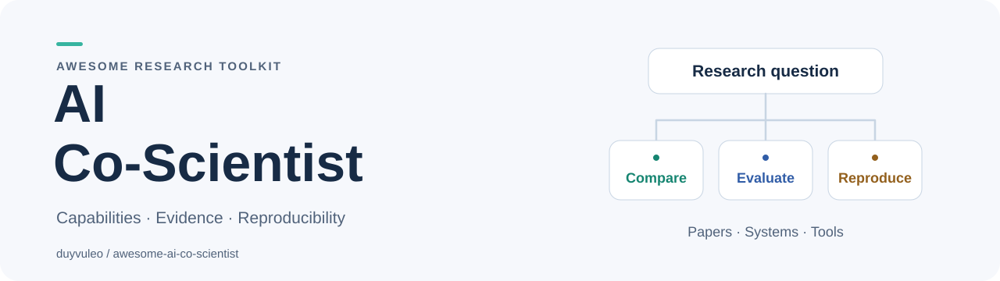
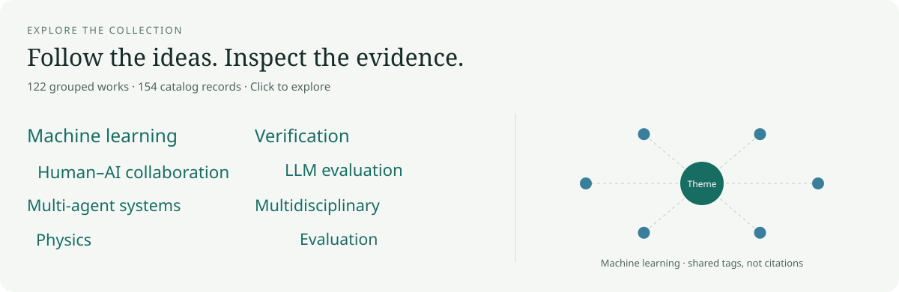

<!-- Generated by scripts/render.py from data/. Edit the source, then regenerate. -->
<picture>
  <source media="(prefers-color-scheme: dark)" srcset="assets/banner-dark.svg">
  
</picture>

# Awesome AI Co-Scientist

> Curated papers, systems, tools, and benchmarks for AI-assisted scientific discovery.

AI agents can propose scientific hypotheses, write and run experimental code, and turn research records into manuscripts. This collection examines systems such as [Google Co-Scientist](docs/systems.md#google-co-scientist-system), [Agentic Scientist](docs/systems.md#agentic-scientist-system), and [DiscoveryRSI](docs/systems.md#discoveryrsi-system): how they work, what they produce, and what their evaluations establish. Compare available code, inspect benchmark results and observed failures, and use evaluation guides to design your own studies.

[Browse papers](docs/papers.md) · [Compare systems](docs/capability-matrix.md) · [Read local experiments](docs/reproducibility.md) · [Contribute](CONTRIBUTING.md)

Latest source check: **2026-11-07**. Entries include summaries, publication status, primary sources, and inspection dates. Papers and software are counted separately.

## Contents

- [Explore visually](#explore-visually)
- [Selected reading](#selected-reading)
- [Choose a reading route](#choose-a-reading-route)
- [Papers](docs/papers.md)
- [Systems](docs/systems.md) and [tools](docs/tools.md)
- [Benchmarks](docs/benchmarks.md)
- [Capability and evidence matrix](docs/capability-matrix.md)
- [Evaluation guide](docs/evaluation-guide.md)
- [Research outputs](docs/research-outputs.md)
- [Research synthesis](docs/research-synthesis.md)
- [Local experiments and study guides](#local-experiments-and-study-guides)
- [Recent additions](#recent-additions)
- [Curation and daily updates](#curation-and-daily-updates)
- [Contributing](#contributing)
- [Related collections](#related-collections)

## Explore visually

Browse research themes, follow resource connections, and inspect the evidence behind each work.

[Open the interactive explorer](https://duyvuleo.github.io/awesome-ai-co-scientist/) · [Methods and coverage](docs/explorer.md)

## Selected reading

Selected resources, newest first. Year-only entries follow dated entries within each year; all catalogs retain topic indexes.

| Date | Resource / status | Summary & evidence | Links |
| --- | --- | --- | --- |
| <code>2026&#8209;10&#8209;13</code> | [The Agentic Scientist: Orchestrating Coding Agents for Automated Scientific (Co-)Discovery](https://arxiv.org/abs/2610.18933) *preprint* | Coordinates coding agents through task drafting, ideas, sandboxed experiments, baselines, ablations, analysis, and manuscript writing. A meta-controller enforces stage-specific rubrics. The paper reports computational discovery studies and an ALIFE 2026 paper produced in a co-scientist setting; that human collaboration should be distinguished from its separate autonomous evaluations. | [Details](docs/papers.md#agentic-scientist) |
| <code>2026&#8209;09&#8209;17</code> | [ScientistTwo: Pioneering the Human Knowledge Frontier with Autonomous AI](https://arxiv.org/abs/2609.19644) *preprint* | Starts from a research problem, establishes baselines, proposes hypotheses, runs experiments and ablations, and iterates through simulated reviews. Evaluation includes publication-derived machine-learning tasks, integrity audits, automated reviewers, and a human study of generated papers. These complementary author-reported assessments remain bounded by the selected tasks; simulated acceptance is distinct from actual venue acceptance. | [Details](docs/papers.md#scientist-two) |
| <code>2026&#8209;09&#8209;15</code> | [ScienceBuddy: Recursive-in-Recursive Self-Improvement for Interactive Scientific Agents](https://arxiv.org/abs/2609.17523) *preprint* | Turns researcher requests, feedback, and execution traces into learning tasks and evaluation rubrics. An inner loop adapts the agent harness while an outer loop trains the model under the improved harness. Case studies cover four scientific task families; they demonstrate the proposed learning workflow rather than universal autonomous discovery. | [Details](docs/papers.md#sciencebuddy) |
| <code>2026&#8209;07&#8209;03</code> | [ResearchStudio](https://github.com/microsoft/ResearchStudio) *preprint* | Microsoft's research skill collection includes Idea for developing literature-grounded research proposals and Reel for turning completed papers into posters, narrated videos, blogs, and interactive presentations. The code exposes editable workflows for coding agents. Its two modules support different stages of research and communication; their presence does not establish an autonomous experimental discovery pipeline. | [Paper](https://arxiv.org/abs/2607.04439) · [Details](docs/tools.md#researchstudio-tool) |
| <code>2026&#8209;05&#8209;25</code> | [ScientistOne: Towards Human-Level Autonomous Research via Chain-of-Evidence](https://arxiv.org/abs/2605.26340) *preprint* | Maintains explicit evidence chains from literature and experiments to manuscript claims, with audits for score reproduction, specification violations, references, and method-code agreement. The authors compare generated papers across research tasks and report improved integrity. These are task-specific audits, so the title's human-level claim should not be generalized to all research. | [Details](docs/papers.md#scientist-one) |
| <code>2026&#8209;05&#8209;19</code> | [Accelerating scientific discovery with Co-Scientist](https://www.nature.com/articles/s41586-026-10644-y) *peer reviewed* | Uses specialized agents to generate, criticize, rank, and evolve hypotheses through tournaments, with scientists setting goals and steering exploration. The Nature paper includes biomedical applications and laboratory validation of selected hypotheses. The system supports scientific reasoning; experimental validation remains a distinct process rather than an automatically closed physical loop. | [Details](docs/papers.md#google-co-scientist) |
| <code>2026&#8209;04&#8209;06</code> | [PaperOrchestra](https://github.com/google-research/paper-orchestra) *preprint* | Transforms research ideas, experimental records, and formatting requirements into LaTeX manuscripts through specialized planning, literature, plotting, writing, and refinement agents. The official Google Research repository accompanies the paper and evaluation resources. It addresses synthesis of existing research materials; manuscript quality ratings do not verify that the underlying experiments or scientific conclusions are correct. | [Paper](https://arxiv.org/abs/2604.05018) · [Details](docs/tools.md#paperorchestra-tool) |
| <code>2026</code> | [OpenResearch](https://github.com/alphaXiv/OpenResearch) *project* | A local research workspace and harness from alphaXiv that connects coding agents to literature discovery, experiment execution, and artifact inspection. It records experiments in a local database and supports multiple compute backends. The repository documents a usable product; these capabilities are project claims rather than an independently established discovery benchmark. | [Details](docs/systems.md#openresearch-system) |
| <code>2025&#8209;04&#8209;02</code> | [PaperBench](https://arxiv.org/abs/2504.01848) *peer reviewed* | Asks agents to implement and execute replications of 20 ICML 2024 papers from scratch. Author-developed hierarchical rubrics divide the work into 8,316 gradable items, with a separately assessed model-based grader. Scores indicate progress toward specified replication requirements; code-only variants, partial rubric credit, and successful empirical replication must be distinguished. | [Code](https://github.com/openai/frontier-evals) · [Details](docs/benchmarks.md#paperbench) |
| <code>2024&#8209;10&#8209;07</code> | [ScienceAgentBench](https://arxiv.org/abs/2410.05080) *peer reviewed* | Contains 102 expert-validated tasks derived from 44 publications across four disciplines. Each task requires a self-contained Python program, assessed through code, execution outputs, and costs. The benchmark deliberately tests individual data-driven research steps, providing a stronger basis for bounded capability claims than treating generated manuscripts as evidence of complete scientific discovery. | [Code](https://github.com/OSU-NLP-Group/ScienceAgentBench) · [Details](docs/benchmarks.md#scienceagentbench) |

## Choose a reading route

| Your question | Where to start |
| --- | --- |
| Which research stages can agents automate? | [Papers](docs/papers.md) and the [capability matrix](docs/capability-matrix.md) |
| What can I inspect or build on? | [Systems](docs/systems.md) and [tools](docs/tools.md), with availability notes |
| Which benchmark fits my experiment? | [Benchmarks](docs/benchmarks.md) and the [evaluation guide](docs/evaluation-guide.md) |
| What has automated research produced? | [Released research outputs](docs/research-outputs.md), including Recursive Flint |
| What has been tested locally? | [Component reproducibility reports](docs/reproducibility.md) |
| Which findings agree, and which questions remain open? | [Cross-paper synthesis](docs/research-synthesis.md) |
| How do agents support laboratory research? | [Domain-science papers](docs/papers.md#topic-domain-science) |

## Scope

We include systems that formulate hypotheses, conduct experiments, analyse results, or communicate scientific findings. Supporting tools and benchmarks are included when their role in these activities is explicit. General-purpose agents require a concrete connection to scientific research.

**Preprint**, **peer-reviewed**, and **project** identify source status. Peer review requires a linked publication record; project entries describe official documentation. **Content checked** records source inspection, not execution. Missing code links indicate unconfirmed availability.

Proposal ratings, successful execution, and validated discoveries measure different outcomes. Comparisons therefore retain the task, budget, human roles, and evaluation setting. Our local reports cover selected components; they do not reproduce complete research campaigns or published scientific findings.

## Local experiments and study guides

| Resource | Purpose |
| --- | --- |
| [Getting started](docs/start-here.md) | Inspect a system, examine a recorded failure, and prepare a study. |
| [Local search and exports](docs/cli.md) | Search, compare, and export catalog records using Python 3.10+. |
| [Evaluation protocols](docs/workflows/README.md) | Study [evaluator integrity](docs/workflows/evaluator-integrity.md), [idea selection](docs/workflows/idea-to-experiment.md), or [human collaboration](docs/workflows/human-ai-collaboration.md). |
| [Study packs](docs/study-packs.md) | Record protocols, budgets, execution details, and results. |
| [Reproducibility reports](docs/reproducibility.md) | Inspect pinned sources, commands, failures, and independent checks. |

Search and planning work offline without model calls. The two recorded component investigations used no paid APIs. Proposed protocols are labelled separately from executed experiments.

## Recent additions

Eight recent works, with one row per work and links to each catalog entry. Ordered by addition date; the Date column shows publication or release.

| Date | Resource / status | Summary & evidence | Links |
| --- | --- | --- | --- |
| <code>2026&#8209;11&#8209;05</code> | [PharmAgents2: Towards Autonomous End-to-End Drug Discovery](https://arxiv.org/abs/2611.07653) *preprint* Added 2026-11-07 | Combines paper-derived and expert-developed skills with parallel hypothesis exploration to deliver drug-discovery candidates. Evaluation separates 121 decision questions, three process-rubric tasks, and three studies followed by human-executed assays. Reported activity and binding support selected candidates, while the proposed LpxH binding site and JAK1 selectivity remain unresolved. An anonymized secondary-target case and system-level comparisons constrain independent scrutiny and attribution to individual components. | [Details](docs/papers.md#pharmagents2) |
| <code>2026&#8209;11&#8209;04</code> | [CLEAR: Structured Specifications for Controllable Long-Horizon ML Research Engineering](https://arxiv.org/abs/2611.06263) *preprint* Added 2026-11-07 | Compiles research artifacts into execution specifications, then coordinates planning, code generation, and localized repair. Author evaluations cover 20 PaperBench papers and 22 MLE-Bench Lite tasks without manual specification review. It supports studying research engineering and cost control; baseline models differ, and the homogeneous-model ablation changes both assignment and backbone. The paper links anonymous code whose contents were not accessible during review. | [Details](docs/papers.md#clear-research-engineering) |
| <code>2026&#8209;11&#8209;03</code> | [A semi-autonomous multi-agent pipeline for high-energy astrophysics research with enforced provenance and verifiable self-extension](https://arxiv.org/abs/2611.05251) *preprint* Added 2026-11-07 | Coordinates literature review, IXPE analysis, and tool creation through deterministic checks, cross-provider code review, and human promotion to a trusted toolkit. Reports constrain numerical claims to declared sources. Author tests stop 64 of 65 planted defects but reject 40 of 69 defect-free controls; provenance alone does not establish correctness. Four related analyses and limited model-tier trials bound the evidence, while detailed event logs are request-only. | [Code](https://github.com/tomthestuka/auto_research) · [Paper details](docs/papers.md#astrophysics-auto-research) · [System details](docs/systems.md#astrophysics-auto-research-system) |
| <code>2026&#8209;11&#8209;03</code> | [DefectSkills: Guiding AI agents through first-principles calculations for point defects in semiconductors and insulators](https://arxiv.org/abs/2611.05654) *preprint* Added 2026-11-07 | Encodes expert decisions and validation steps as prompts for VASP point-defect calculations, from structure relaxation through defect thermodynamics. A BaCd2P2 demonstration produces calculation and analysis outputs with researcher intervention for restart diagnosis, directory mapping, and substitution of the prescribed solver. It offers an inspectable scientific workflow; one material, refined prompts, and human corrections do not establish unattended reliability across materials. | [Code](https://github.com/zy75-prog/DefectSkills) · [Paper details](docs/papers.md#defectskills) · [Tool details](docs/tools.md#defectskills-tool) |
| <code>2026&#8209;11&#8209;04</code> | [FrontierPhysics](https://arxiv.org/abs/2611.06910) *preprint* Added 2026-11-06 | Provides 56 physics research tasks requiring structured results and manuscripts, combining deterministic verifiers with agent-graded expert rubrics. Passing requires every verifier test and blocking criterion; non-blocking ratings assess quality. Audits of one model’s 168-rollout cohort identify grading defects, with affected tasks rerun or regraded. Reviewer-family leniency, model/harness differences, and versioned task repairs constrain comparisons. Graded publishability is a proxy, not actual publication acceptance. | [Details](docs/benchmarks.md#frontierphysics) |
| <code>2026&#8209;11&#8209;03</code> | [Goal-Driven Autonomous Optical Experimentation via a Self-Recursive Hardware-Software Harness](https://arxiv.org/abs/2611.04481) *preprint* Added 2026-11-06 | Demonstrates goal-directed revision of display-control software, measurement protocols, and response models in one optical see-through color-matching setup. A USB-controlled RGB hold/acknowledgement interface makes model-selected stimuli measurable; spectrometer feedback improves five target matches. A separate model revision helps seven of nine new tests, with two regressions. Evidence is bounded to one apparatus and geometry; conceptual cross-goal self-recursion extends beyond what these cases validate. | [Code](https://github.com/TZHU64/SpectralColorLab) · [Paper details](docs/papers.md#self-recursive-optical-research) · [Tool details](docs/tools.md#spectralcolorlab) |
| <code>2026&#8209;11&#8209;03</code> | [Verifier strength does not buy discovery quality: a pre-registered two-domain test of LLM-based automated research, with post-hoc evidence pointing to proposer-pool composition](https://arxiv.org/abs/2611.04420) *preprint* Added 2026-11-06 | Re-gates fixed LLM and random proposal pools through three verifier tiers in scheduling and simulated edge offloading. Under author-reported frozen criteria, stricter filtering does not produce the predicted increasing held-out advantage. Two lower gates usually select identical candidates. Exploratory pool merging helps scheduling but not offloading. One 0.5B proposer, correlated proposals, weak tier separation in one domain, and an unreachable strict-order criterion limit generalization. | [Details](docs/papers.md#verifier-strength-pool-composition) |
| <code>2026&#8209;11&#8209;02</code> | [Are LLM Research Agents Reliable Judges of Predictability? Evidence from Planted-Signal Worlds](https://arxiv.org/abs/2611.04070) *preprint* Added 2026-11-06 | Treats research agents’ forecasting verdicts as statistical tests in planted-signal simulations, with framing variants, sealed test windows, and classical baselines. Apparent detection advantages weaken when false-positive rates are matched; excess false claims persist after removing a resampling artifact. The brief does not fix a significance level, and stronger in-sample comparisons are exploratory. Results cover one scaffold and a limited model set, without establishing reliability across scientific research. | [Details](docs/papers.md#planted-signal-research-agents) |

See the [changelog](CHANGELOG.md) for additions and corrections, and the [search notes](docs/search-papers.md) for source checks and coverage.

## Curation and daily updates

Daily curation checks primary sources for new work and project changes. We publish substantive additions and corrections after validation. See the [search protocol](docs/search-protocol.md) for coverage limits and the [changelog](CHANGELOG.md) for updates; coverage is not exhaustive.

This collection is AI-assisted and maintainer-owned. Automated checks validate catalog structure and generated files; scientific claims require source review.

## Contributing

Suggest a [resource or correction](https://github.com/duyvuleo/awesome-ai-co-scientist/issues/new?template=resource.yml), report a [reproduction attempt](https://github.com/duyvuleo/awesome-ai-co-scientist/issues/new?template=reproduction.yml), or share [practical experience](https://github.com/duyvuleo/awesome-ai-co-scientist/issues/new?template=experience.yml). Include sources, methods, and limitations; failed attempts are welcome. See the [contribution guide](CONTRIBUTING.md) and [open contribution topics](docs/community-roadmap.md).

The catalogs in [data/](data/) generate the indexes. The [data reference](docs/data-reference.md) explains their structure and reuse. Cite primary papers for scientific claims; use [CITATION.cff](CITATION.cff) and a commit ID when citing this collection.

## Related collections

- [Awesome Reliable Text-to-SQL](https://github.com/duyvuleo/awesome-reliable-text-to-sql) — A companion collection on ambiguity, clarification, and unanswerability.
- [Related AI-science collections](docs/search-landscape.md) — Coverage and differences among existing lists.
- [Awesome manifesto](https://github.com/sindresorhus/awesome/blob/main/awesome.md) — Guidance for curated collections. This repository is independent of the central index, whose [contribution rules](https://github.com/sindresorhus/awesome/blob/main/pull_request_template.md) exclude AI-generated lists.

## License

Original annotations, catalog records, and scripts use [CC0 1.0](LICENSE). Linked papers, software, data, and trademarks retain their respective terms.
