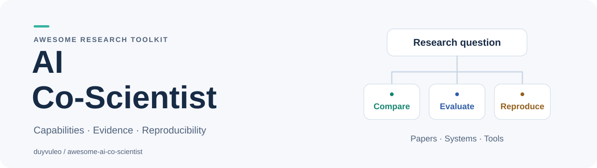
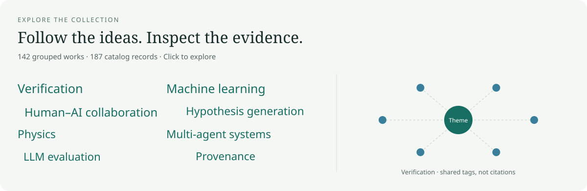

<!-- Generated by scripts/render.py from data/. Edit the source, then regenerate. -->
<picture>
  <source media="(prefers-color-scheme: dark)" srcset="assets/banner-dark.svg">
  
</picture>

# Awesome AI Co-Scientist

> Curated papers, systems, tools, and benchmarks for AI-assisted scientific discovery.

AI agents can propose scientific hypotheses, write and run experimental code, and turn research records into manuscripts. This collection examines systems such as [Google Co-Scientist](docs/systems.md#google-co-scientist-system), [Agentic Scientist](docs/systems.md#agentic-scientist-system), and [DiscoveryRSI](docs/systems.md#discoveryrsi-system): how they work, what they produce, and what their evaluations establish. Compare available code, inspect benchmark results and observed failures, and use evaluation guides to design your own studies.

[Browse papers](docs/papers.md) · [Full-text notes](docs/full-text-review.md) · [Compare systems](docs/capability-matrix.md) · [Read local experiments](docs/reproducibility.md) · [Contribute](CONTRIBUTING.md)

Latest source check: **2026-11-23**. Entries include summaries, publication status, primary sources, and inspection dates. Papers and software are counted separately.

## Contents

- [Explore visually](#explore-visually)
- [Selected reading](#selected-reading)
- [Choose a reading route](#choose-a-reading-route)
- [Papers](docs/papers.md)
- [Systems](docs/systems.md) and [tools](docs/tools.md)
- [Benchmarks](docs/benchmarks.md)
- [Capability and evidence matrix](docs/capability-matrix.md)
- [Full-text reading notes](docs/full-text-review.md)
- [Evaluation guide](docs/evaluation-guide.md)
- [Research outputs](docs/research-outputs.md)
- [Research synthesis](docs/research-synthesis.md)
- [Local experiments and study guides](#local-experiments-and-study-guides)
- [Recent additions](#recent-additions)
- [Curation and daily updates](#curation-and-daily-updates)
- [Contributing](#contributing)
- [Related collections](#related-collections)

## Explore visually

Browse research themes, follow resource connections, and inspect the evidence behind each work.

[Open the interactive explorer](https://duyvuleo.github.io/awesome-ai-co-scientist/) · [Methods and coverage](docs/explorer.md)

## Selected reading

Selected resources, newest first. Year-only entries follow dated entries within each year; all catalogs retain topic indexes.

| Date | Resource / status | Summary & evidence | Links |
| --- | --- | --- | --- |
| <code>2026&#8209;10&#8209;13</code> | [The Agentic Scientist: Orchestrating Coding Agents for Automated Scientific (Co-)Discovery](https://arxiv.org/abs/2610.18933) *preprint* | Coordinates coding agents through typed hypothesis contracts, sandboxed experiments, shared memory, retrospective ablations, and evidence-linked manuscript audits. Evaluation includes 70 computational ML campaigns scored by an AI-reviewer proxy and separate held-out case studies. Its single accepted ALIFE paper involved substantial human specification, verification, statistical analysis, and editing; automated rubric gates also missed evaluation-protocol changes. | [Details](docs/papers.md#agentic-scientist) |
| <code>2026&#8209;09&#8209;17</code> | [ScientistTwo: Pioneering the Human Knowledge Frontier with Autonomous AI](https://arxiv.org/abs/2609.19644) *preprint* | Coordinates limitation-driven hypotheses, subset-to-full experiments, ablation-based refinement, and simulated review–rebuttal cycles that can trigger supplementary experiments. Across 107 selected ML-paper challenges, it reports 86 successful improvements; gains and most review scores condition on those successes. Acceptance figures come from automated reviewers, with a 33-paper human assessment; reported cost averages about $3,765 per completed NeurIPS-derived task. | [Details](docs/papers.md#scientist-two) |
| <code>2026&#8209;09&#8209;15</code> | [ScienceBuddy: Recursive-in-Recursive Self-Improvement for Interactive Scientific Agents](https://arxiv.org/abs/2609.17523) *preprint* | Provides a biomedical workspace that couples instruction/skill-harness revision with model reinforcement learning. Case studies report fixed-model adaptation, fixed-harness pass@4 gains, and three alternating update cycles on scientific QA tasks. Real researcher interactions illustrate task and rubric construction; the controlled adaptation experiment uses bounded simulated feedback, and individual feedback or skill contributions are not isolated. | [Details](docs/papers.md#sciencebuddy) |
| <code>2026&#8209;07&#8209;03</code> | [ResearchStudio](https://github.com/microsoft/ResearchStudio) *preprint* | Microsoft’s ResearchStudio provides Idea for literature-grounded proposal development and Reel for editable posters, narrated videos, blogs, and an aligned viewer. Idea is assessed through automated proposal judgments; Reel’s quantitative study covers posters, while other outputs remain capability demonstrations. Their shared repository supports distinct research stages rather than establishing a fully autonomous experimental discovery pipeline. | [Paper](https://arxiv.org/abs/2607.04439) · [Details](docs/tools.md#researchstudio-tool) |
| <code>2026&#8209;05&#8209;25</code> | [ScientistOne: Towards Human-Level Autonomous Research via Chain-of-Evidence](https://arxiv.org/abs/2605.26340) *preprint* | Links literature notes, code-search artifacts, and manuscript claims through a Chain-of-Evidence workflow and four-part integrity audit. In 75 adapted ADRS runs, it reports strong score reproduction and reference identity checks, with human correction of flagged audit results. Majority-vote checks still miss documented exploits; MLE-bench medal results use repeated test-grader feedback rather than the official single-submission protocol. | [Details](docs/papers.md#scientist-one) |
| <code>2026&#8209;05&#8209;19</code> | [Accelerating scientific discovery with Co-Scientist](https://www.nature.com/articles/s41586-026-10644-y) *peer reviewed* | Google’s Gemini-based Co-Scientist generates, critiques and evolves research hypotheses through literature search and Elo-ranked agent debates. Expert-guided evaluations include selected AML drug and combination assays, liver-organoid tests and rediscovery of unpublished antimicrobial-resistance findings. Human screening and laboratory work remain central; several candidates failed, biological effects were context dependent, and automated Elo scores do not establish general scientific correctness. | [Details](docs/papers.md#google-co-scientist) |
| <code>2026&#8209;04&#8209;06</code> | [PaperOrchestra](https://github.com/google-research/paper-orchestra) *preprint* | Turns supplied ideas and experimental records into LaTeX manuscripts using planning, literature, plotting, writing, and refinement agents. On a benchmark reconstructed from 200 accepted papers, human reviewers prefer its drafts to two writing baselines. These comparisons assess manuscript quality; citation-identity checks and simulated acceptance do not validate underlying science, and generated figures and model-driven refinement require independent review. | [Paper](https://arxiv.org/abs/2604.05018) · [Details](docs/tools.md#paperorchestra-tool) |
| <code>2026</code> | [OpenResearch](https://github.com/alphaXiv/OpenResearch) *project* | Research workspace connects coding agents to literature, experiment execution and artifact inspection, retaining local SQL experiment records and multiple compute backends. Documented features include run monitoring, visualizations and stop/recovery controls. The v0.2.30 release adds project-specific settings and reports fixes to project moves and resumed usage accounting. Installation, runtime behavior and scientific effectiveness were not independently tested. | [Details](docs/systems.md#openresearch-system) |
| <code>2025&#8209;04&#8209;02</code> | [PaperBench](https://arxiv.org/abs/2504.01848) *peer reviewed* | Measures reconstruction of 20 ML papers from scratch using author-approved rubrics, clean-environment execution, and an LLM grader. Scores combine partial credit for code, execution, and result matching; they are not the fraction of papers fully reproduced. Human comparisons cover a small selected subset with different selection and time budgets. The cheaper Code-Dev variant omits execution and result verification. | [Code](https://github.com/openai/frontier-evals) · [Details](docs/benchmarks.md#paperbench) |
| <code>2024&#8209;10&#8209;07</code> | [ScienceAgentBench](https://arxiv.org/abs/2410.05080) *peer reviewed* | A 102-task benchmark for generating executable Python programs that process, analyze and visualize scientific data across four disciplines. Expert validation, dataset modifications, task-specific outcome checks and human process rubrics support evaluation. Comparisons of prompting, self-debug and OpenHands show that successful execution can still produce scientifically incorrect results. Reported headline success uses the best of three attempts; tasks and source materials cover a bounded portion of scientific workflows. | [Code](https://github.com/OSU-NLP-Group/ScienceAgentBench) · [Details](docs/benchmarks.md#scienceagentbench) |

## Choose a reading route

| Your question | Where to start |
| --- | --- |
| Which research stages can agents automate? | [Papers](docs/papers.md) and the [capability matrix](docs/capability-matrix.md) |
| What can I inspect or build on? | [Systems](docs/systems.md) and [tools](docs/tools.md), with availability notes |
| Which benchmark fits my experiment? | [Benchmarks](docs/benchmarks.md) and the [evaluation guide](docs/evaluation-guide.md) |
| What has automated research produced? | [Released research outputs](docs/research-outputs.md), including Recursive Flint |
| What has been tested locally? | [Component reproducibility reports](docs/reproducibility.md) |
| Which findings agree, and which questions remain open? | [Cross-paper synthesis](docs/research-synthesis.md) |
| What do the full papers establish? | [Reading notes](docs/full-text-review.md), with methods, evaluation limits, and access gaps |
| How do agents support laboratory research? | [Domain-science papers](docs/papers.md#topic-domain-science) |

## Scope

We include systems that formulate hypotheses, conduct experiments, analyse results, or communicate scientific findings. Supporting tools and benchmarks are included when their role in these activities is explicit. General-purpose agents require a concrete connection to scientific research.

**Preprint**, **peer-reviewed**, and **project** identify source status. Peer review requires a linked publication record; project entries describe official documentation. **Content checked** records source inspection, not execution. Missing code links indicate unconfirmed availability.

Proposal ratings, successful execution, and validated discoveries measure different outcomes. Comparisons therefore retain the task, budget, human roles, and evaluation setting. Our local reports cover selected components; they do not reproduce complete research campaigns or published scientific findings.

## Local experiments and study guides

| Resource | Purpose |
| --- | --- |
| [Getting started](docs/start-here.md) | Inspect a system, examine a recorded failure, and prepare a study. |
| [Local search and exports](docs/cli.md) | Search, compare, and export catalog records using Python 3.10+. |
| [Evaluation protocols](docs/workflows/README.md) | Study [evaluator integrity](docs/workflows/evaluator-integrity.md), [idea selection](docs/workflows/idea-to-experiment.md), or [human collaboration](docs/workflows/human-ai-collaboration.md). |
| [Study packs](docs/study-packs.md) | Record protocols, budgets, execution details, and results. |
| [Reproducibility reports](docs/reproducibility.md) | Inspect pinned sources, commands, failures, and independent checks. |

Search and planning work offline without model calls. The two recorded component investigations used no paid APIs. Proposed protocols are labelled separately from executed experiments.

## Recent additions

Eight recent works, with one row per work and links to each catalog entry. Ordered by addition date; the Date column shows publication or release.

| Date | Resource / status | Summary & evidence | Links |
| --- | --- | --- | --- |
| <code>2026&#8209;11&#8209;11</code> | [Science Prediction Universe](https://arxiv.org/abs/2611.15049) *preprint* Added 2026-11-23 | Evaluates tool-using agents on ranking withheld experimental outcomes from published-study tasks and unpublished laboratory campaigns. A separate deterministic grader measures rank agreement, while trajectory analyses examine proxies, effort and shared errors. Model/harness combinations, pilot-based task selection, refusal-dependent coverage and possible public-answer exposure constrain comparisons. Current released tasks include reference answers and differ from the paper version; outcome ranking does not establish open-ended discovery or autonomous experimental execution. | [Paper details](docs/papers.md#science-prediction-universe) · [Benchmark details](docs/benchmarks.md#spu-benchmark) |
| <code>2026&#8209;11&#8209;07</code> | [Embodied Science Agents: Making Embodied Experimental Design Learnable](https://arxiv.org/abs/2611.12958) *preprint* Added 2026-11-23 | Combines memory-guided planning and Gaussian-process optimisation with API, GUI and demonstration-trained robotic control to run electrochemical experiments. One fifteen-round campaign reports higher transmittance for a prepared Safranine T solution; its residual-dye interpretation does not establish mineralisation. Offline manipulation training, three illustrated placement trials, missing component baselines and incomplete recipe/automation details limit claims of general scientific learning or wastewater-treatment deployment. | [Details](docs/papers.md#embodied-science-agents) |
| <code>2026&#8209;11&#8209;10</code> | [Contrastive Discovery: Open-Ended Scientific Discovery over Competing Explanations](https://arxiv.org/abs/2611.14514) *preprint* Added 2026-11-22 | Represents each research question as competing explanations, elicits beliefs before and after computational analysis, and uses belief redistribution to guide tree search. Six observational datasets yield more model-defined resolutions than pointwise baselines, with human and numerical checks. Resolution remains conditional on supplied alternatives and analyses; omitted-answer tests, limited end-to-end recovery, prompt differences and unverified implementation availability constrain claims about scientific truth or general discovery. | [Details](docs/papers.md#contrastive-discovery) |
| <code>2026&#8209;11&#8209;16</code> | [AI Scientist Discovered Robust Quantum Control](https://arxiv.org/abs/2611.21765) *preprint* Added 2026-11-21 | Couples constrained pulse-sequence proposal and exact-diagonalization screening to instrument calibration and physical tests on spin-1 nitrogen-vacancy ensembles. Agents search 18-pulse blocks and compose longer cycles; author measurements show improved coherence against DROID-C3PO in the tested setting. Scientists define objectives, supervise and supply the physical interpretation afterward. One apparatus, inherited search structure, absent component ablations and incomplete search/measurement reporting limit claims of general autonomous discovery. | [Details](docs/papers.md#qora-quantum-control) |
| <code>2026&#8209;11&#8209;16</code> | [DiscoveryAgent: A Framework for Scientist-centric Agentic AI](https://arxiv.org/abs/2611.21950) *preprint* Added 2026-11-20 | Organizes computational research into autonomous hypothesis-testing rounds with scientist steering, separate empirical and procedural memories, and checkpoint-based audit agents. Two predictive tasks and three expert-led case studies report useful models and analyses. Unequal model and resource budgets limit attribution to steering; synthetic-error audits and an eight-person human study assess trace interrogation. Some headline findings come from author-led follow-up analyses rather than the original agent runs. | [Code](https://github.com/owencqueen/DiscoveryAgent-code) · [Paper details](docs/papers.md#discoveryagent-scientist-centric) · [System details](docs/systems.md#discoveryagent-system) |
| <code>2026&#8209;11&#8209;15</code> | [Eliciting Research Taste in LLMs through Future Research Direction Choice](https://arxiv.org/abs/2611.19794) *preprint* Added 2026-11-19 | Measures research-direction preference by choosing between an author-recommended future work item and a plausible alternative from a related paper, in both option orders. Eight models evaluated on 80 pairs from 19 ML papers show author alignment and order-stable divergence. These are behavioral preference measures, not scientific-quality scores. Single-sample elicitation, shared-model data construction, correlated source papers and a human pilot with a different protocol limit conclusions about research taste or downstream innovation. | [Code](https://github.com/Lossfunk/research-taste-eval-v1) · [Paper details](docs/papers.md#research-taste-future-direction-choice) · [Benchmark details](docs/benchmarks.md#research-taste-eval) |
| <code>2026&#8209;11&#8209;13</code> | [Interpretable weight-space programming builds transparent transformers and brain encoding models](https://arxiv.org/abs/2611.18114) *preprint* Added 2026-11-18 | A coding agent writes interpretable network weights or stimulus features, revising them from a fixed evaluator’s feedback. Brain-encoding experiments fit ridge readouts and test feature transfer; readable programs expose a scan-timing confound and complement Whisper. The no-training constraint applies to constructed features, not the fitted readout. Mostly known motifs, post-hoc audits, small observational samples and substantial search costs limit claims of new biological mechanisms or general innovation. | [Code](https://github.com/csinva/weight-space-programming-autoresearch) · [Paper details](docs/papers.md#interpretable-weight-space-programming) · [Tool details](docs/tools.md#iwsp-research-code) |
| <code>2026&#8209;11&#8209;01</code> | [CONFIRM: Governing Scientific Reporting for Trustworthy Agentic Neuroimaging](https://arxiv.org/abs/2611.01449) *preprint* Added 2026-11-17 | Freezes neuroimaging analysis plans and delegates reporting to five deterministic gates, with diagnosis-guided follow-up. In the matched scalar comparison, the default Full standard accepts no designed controls but recovers 15 of 31 literature-supported claims and accepts two of 15 literature-unsupported claims. Gate-aligned controls, limited reference coverage, selected holdout coverage and threshold assumptions limit interpretation. Passing establishes support under declared checks rather than biological truth. | [Code](https://github.com/yuxiangwei0808/CONFIRM) · [Paper details](docs/papers.md#confirm) · [Tool details](docs/tools.md#confirm-tool) · [Benchmark details](docs/benchmarks.md#neuroclaimbench) |

See the [changelog](CHANGELOG.md) for additions and corrections, and the [search notes](docs/search-papers.md) for source checks and coverage.

## Curation and daily updates

Daily curation checks primary sources for new work and project changes. We publish substantive additions and corrections after validation. See the [search protocol](docs/search-protocol.md) for coverage limits and the [changelog](CHANGELOG.md) for updates; coverage is not exhaustive.

This collection is AI-assisted and maintainer-owned. Automated checks validate catalog structure and generated files; scientific claims require source review.

## Contributing

Suggest a [resource or correction](https://github.com/duyvuleo/awesome-ai-co-scientist/issues/new?template=resource.yml), report a [reproduction attempt](https://github.com/duyvuleo/awesome-ai-co-scientist/issues/new?template=reproduction.yml), or share [practical experience](https://github.com/duyvuleo/awesome-ai-co-scientist/issues/new?template=experience.yml). Include sources, methods, and limitations; failed attempts are welcome. See the [contribution guide](CONTRIBUTING.md) and [open contribution topics](docs/community-roadmap.md).

The catalogs in [data/](data/) generate the indexes. The [data reference](docs/data-reference.md) explains their structure and reuse. Cite primary papers for scientific claims; use [CITATION.cff](CITATION.cff) and a commit ID when citing this collection.

## Related collections

- [Awesome Reliable Text-to-SQL](https://github.com/duyvuleo/awesome-reliable-text-to-sql) — A companion collection on ambiguity, clarification, and unanswerability.
- [Related AI-science collections](docs/search-landscape.md) — Coverage and differences among existing lists.
- [Awesome manifesto](https://github.com/sindresorhus/awesome/blob/main/awesome.md) — Guidance for curated collections. This repository is independent of the central index, whose [contribution rules](https://github.com/sindresorhus/awesome/blob/main/pull_request_template.md) exclude AI-generated lists.

## License

Original annotations, catalog records, and scripts use [CC0 1.0](LICENSE). Linked papers, software, data, and trademarks retain their respective terms.
